# 数据库比对与同步工具（db-compare）

基于 Spring Boot + Thymeleaf 的 Web 工具：管理数据源、全库比对、数据同步、数据浏览与报告导出。  
支持 **MySQL / GoldenDB / PostgreSQL / Oracle / SQL Server / H2 / SQLite**。  
1当前版本：**v1.2.82**（详见 [`src/main/resources/version-changelog.json`](src/main/resources/version-changelog.json)）。

---

## 核心能力（v1.2.82）

| 模块 | 能力 |
|------|------|
| **数据源** | 多库类型注册、连接测试、密码加密存储；独立 H2 库 `./data/datasource`；全量/增量 SQL 导出 |
| **比对** | 全量 / 抽样 / 增量比对；条数、金额、行 Hash；超大表自动跳过 Hash；**指定表详细比对**（任意表，含条数一致时的状态等字段差异）并定位差异行，生成源·目标 SQL |
| **同步** | DML / DDL / 增量 / PK_UPSERT / 数据传输 / 数据同步 / **DataX**；表级并行、心跳与看门狗 |
| **报告** | 比对/同步 HTML+MD 报告；条数差异提取同步草稿；失败表一键重同步；比对任务可重新执行 |
| **浏览** | 类 Navicat 全屏数据浏览，分页查询任意已注册数据源 |
| **安全** | 全站登录认证（`db-compare.security`）；未登录禁止访问页面/API/报告 |
| **运维** | 参数设置（并行、批次、DataX 目录等）；应用内版本日志；schema 增量迁移 |

### 同步模式一览

| 模式 | 说明 | 典型场景 |
|------|------|----------|
| **FULL_DML** | 分批 DELETE + 批量 INSERT | 无 DDL 权限（默认） |
| **FULL_DDL** | TRUNCATE 或 CREATE LIKE + RENAME | 有 DDL，大表更快 |
| **INCREMENTAL** | INSERT IGNORE，不清空 | 增量追加 |
| **PK_UPSERT** | 按主键 UPDATE + INSERT | 差异较小 |
| **DATA_TRANSFER** | 清空后全量写入 | 类 Navicat 数据传输 |
| **DATA_SYNC** | 按主键 INSERT/UPDATE/DELETE 归并 | 类 Navicat 数据同步 |
| **DATAX** | 调用本机 DataX 多通道写入 | 千万级以上大表 |

---

## 截图使用手册

> 截图由 `node scripts/capture-screenshots.mjs` 生成（需应用已启动）。完整步骤见 [`docs/manual/README.md`](docs/manual/README.md)。  
> 所有截图位于仓库目录 [`docs/manual/images/`](docs/manual/images/)。

| 页面 | 路径 |
|------|------|
| 登录 | [`docs/manual/images/01-login.png`](docs/manual/images/01-login.png) |
| 首页 | [`docs/manual/images/02-home.png`](docs/manual/images/02-home.png) |
| 数据源列表 | [`docs/manual/images/03-datasource-list.png`](docs/manual/images/03-datasource-list.png) |
| 添加数据源 | [`docs/manual/images/04-datasource-form.png`](docs/manual/images/04-datasource-form.png) |
| 比对配置 | [`docs/manual/images/05-compare-config.png`](docs/manual/images/05-compare-config.png) |
| 同步列表 | [`docs/manual/images/06-sync-list.png`](docs/manual/images/06-sync-list.png) |
| 同步配置 | [`docs/manual/images/07-sync-config.png`](docs/manual/images/07-sync-config.png) |
| 报告列表 | [`docs/manual/images/08-report-list.png`](docs/manual/images/08-report-list.png) |
| 数据浏览 | [`docs/manual/images/09-viewer.png`](docs/manual/images/09-viewer.png) |
| 参数设置 | [`docs/manual/images/10-settings.png`](docs/manual/images/10-settings.png) |
| 比对报告 | [`docs/manual/images/11-compare-report.png`](docs/manual/images/11-compare-report.png) |
| 同步报告 | [`docs/manual/images/12-sync-report.png`](docs/manual/images/12-sync-report.png) |
| 同步确认 | [`docs/manual/images/13-sync-confirm.png`](docs/manual/images/13-sync-confirm.png) |

### 1. 登录

默认账号见 `application.yml` → `db-compare.security`，生产环境请立即修改。

[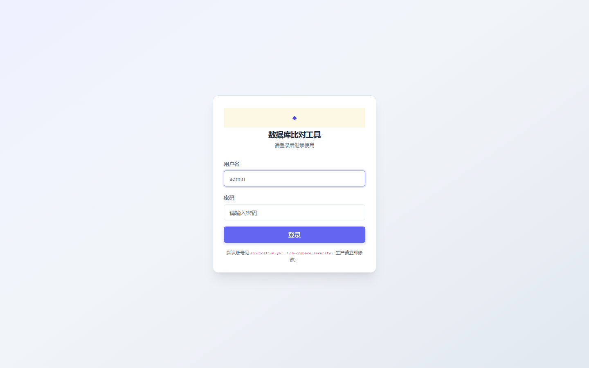](docs/manual/images/01-login.png)

`docs/manual/images/01-login.png`

### 2. 首页

导航栏可进入各功能模块；点击版本号查看更新日志。

[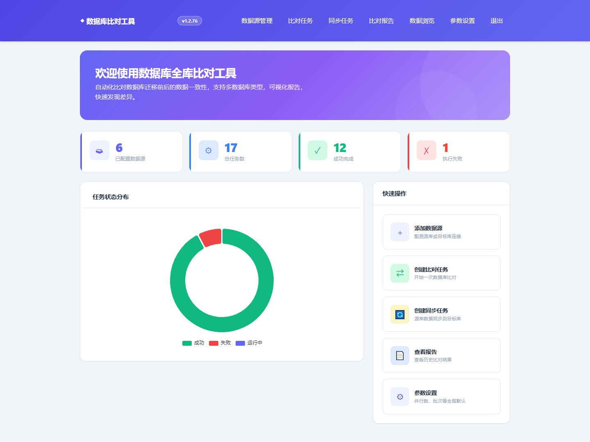](docs/manual/images/02-home.png)

`docs/manual/images/02-home.png`

### 3. 数据源管理

注册源库/目标库，支持直连与**堡垒机（JumpServer）** Token 连接。

[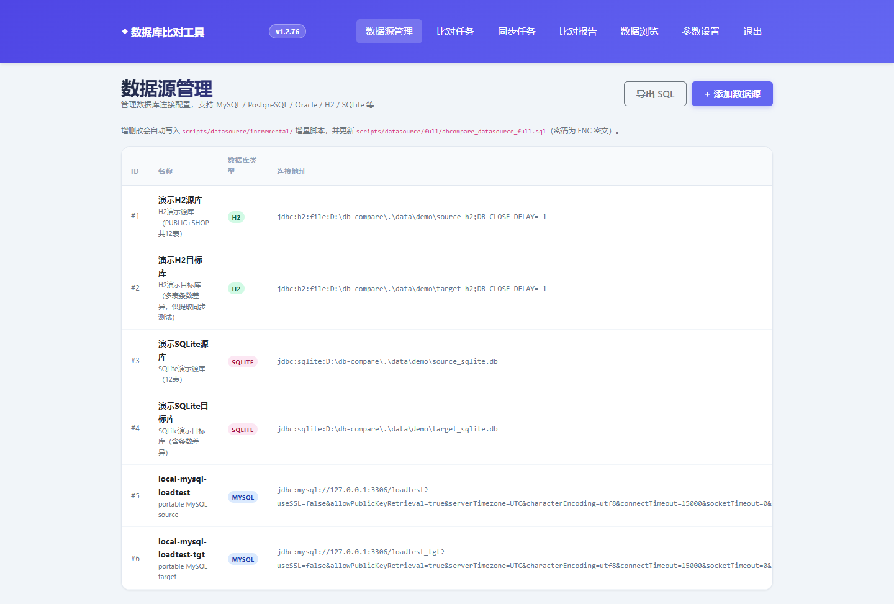](docs/manual/images/03-datasource-list.png)

`docs/manual/images/03-datasource-list.png`

添加数据源时，MySQL/GoldenDB 可展开堡垒机面板，填入堡垒机主机、端口、Token 用户名/密码，库名填 Schema 后点「应用堡垒机配置」。

[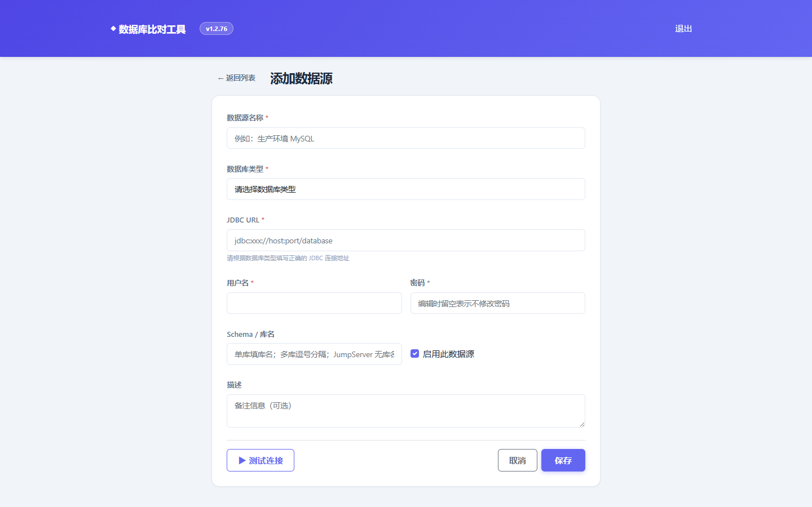](docs/manual/images/04-datasource-form.png)

`docs/manual/images/04-datasource-form.png`

### 4. 比对任务

选择源/目标数据源、库名映射、比对模式与表范围，提交后在进度页查看状态。

[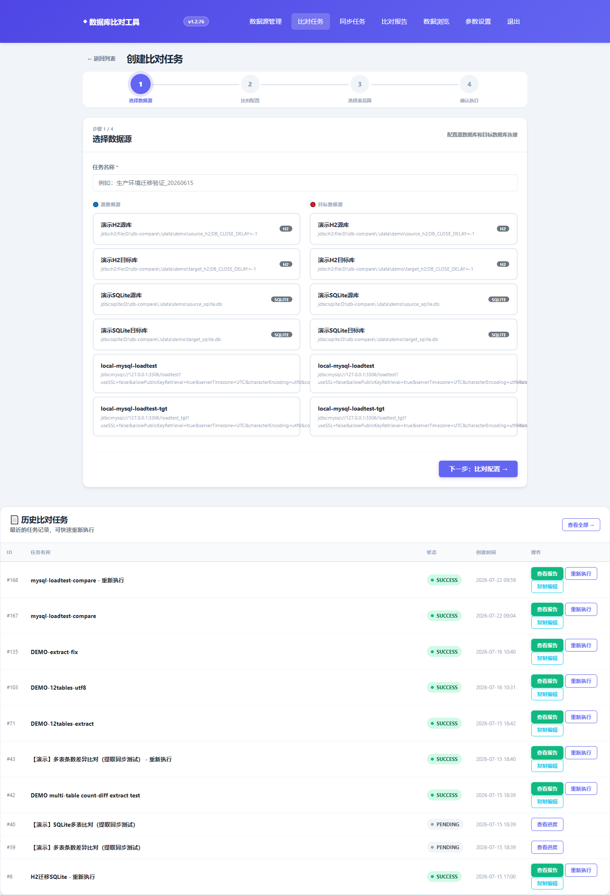](docs/manual/images/05-compare-config.png)

`docs/manual/images/05-compare-config.png`

### 5. 同步任务

支持多种同步模式；PENDING 草稿可编辑确认后再执行。

[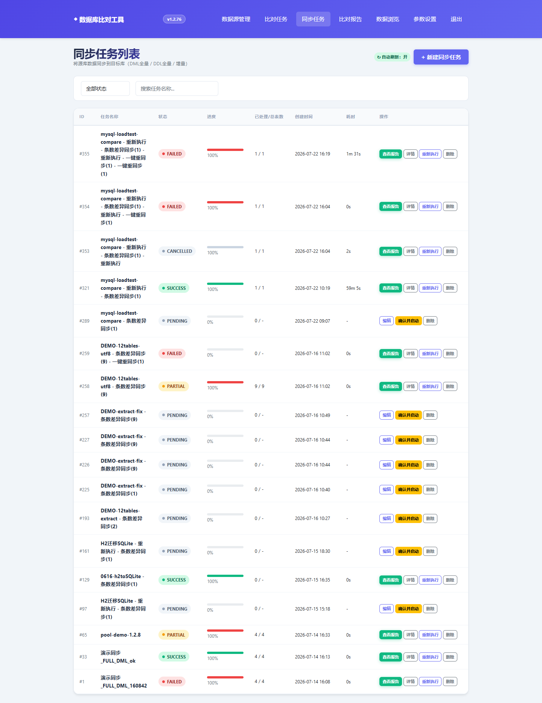](docs/manual/images/06-sync-list.png)

`docs/manual/images/06-sync-list.png`

[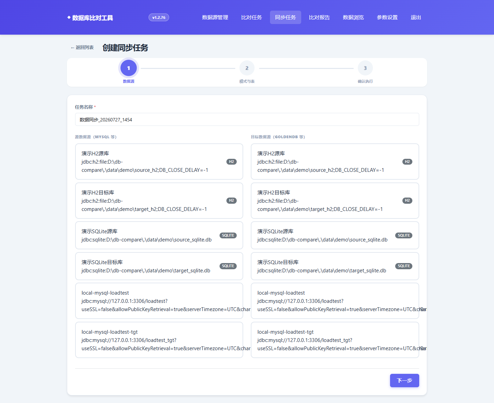](docs/manual/images/07-sync-config.png)

`docs/manual/images/07-sync-config.png`

[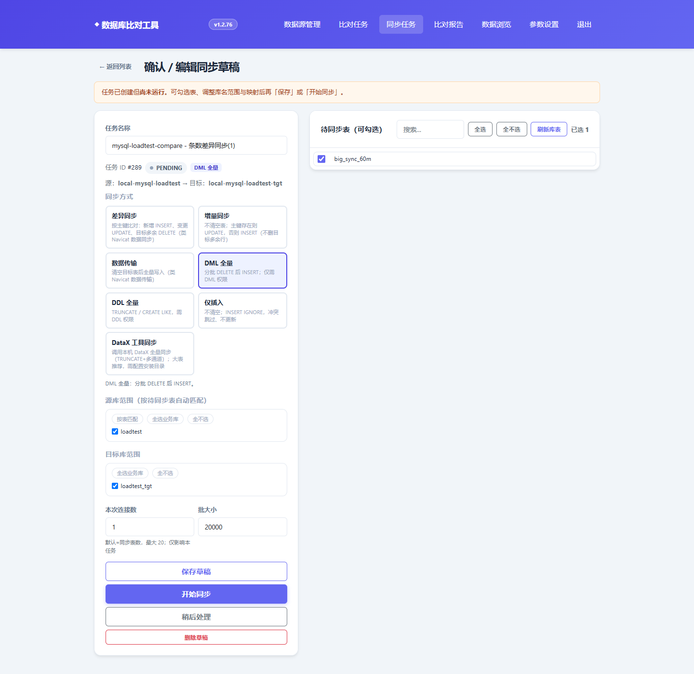](docs/manual/images/13-sync-confirm.png)

`docs/manual/images/13-sync-confirm.png`

### 6. 报告

比对报告与同步报告分栏展示；支持查看条数差异、提取同步、重新执行。

[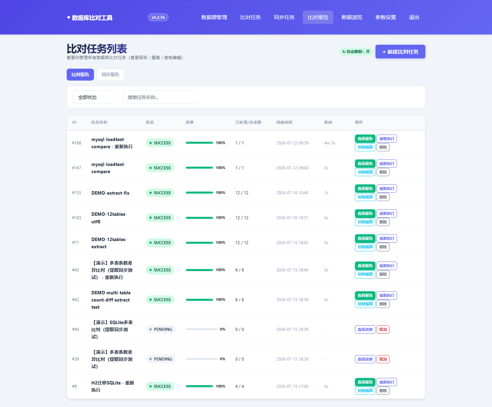](docs/manual/images/08-report-list.png)

`docs/manual/images/08-report-list.png`

[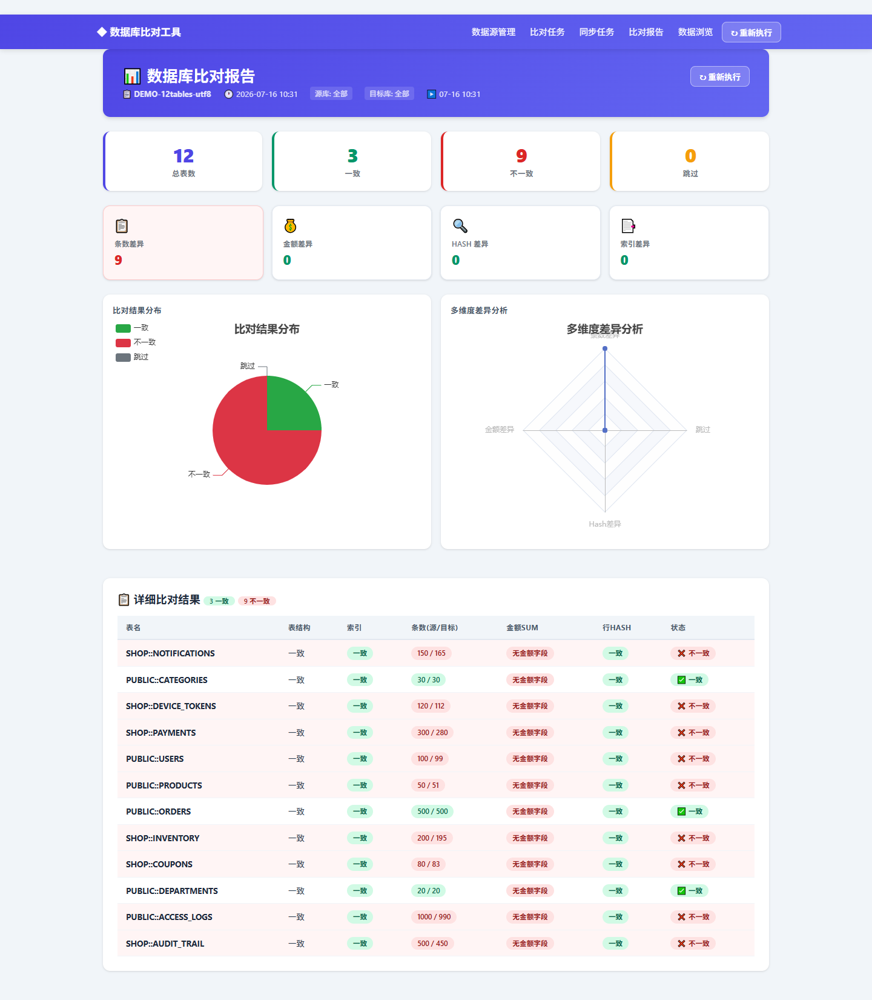](docs/manual/images/11-compare-report.png)

`docs/manual/images/11-compare-report.png`

[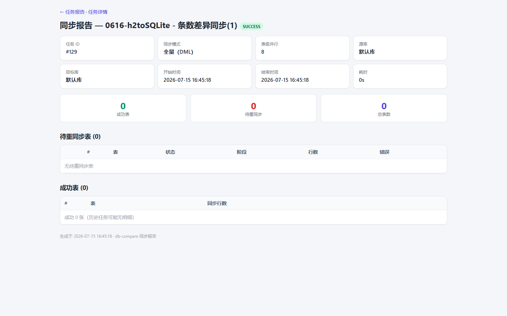](docs/manual/images/12-sync-report.png)

`docs/manual/images/12-sync-report.png`

### 7. 数据浏览

选择数据源与表，分页浏览数据。

[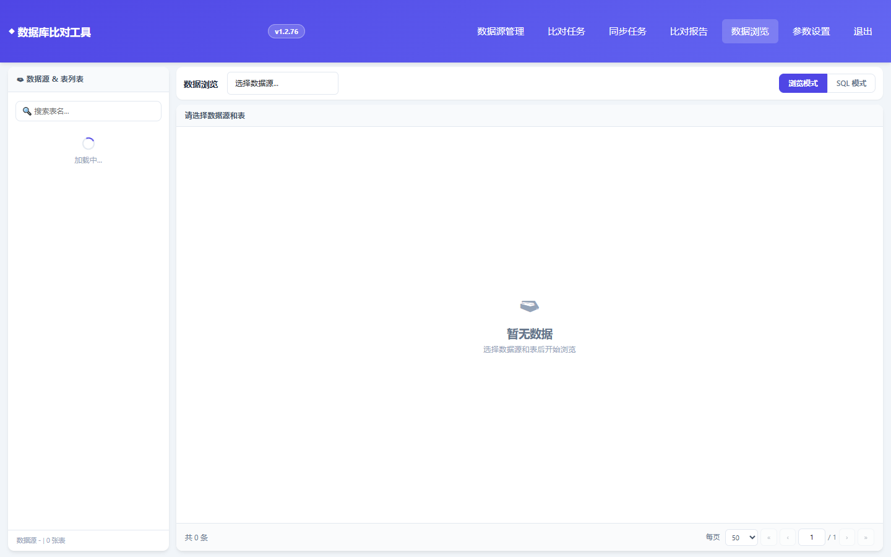](docs/manual/images/09-viewer.png)

`docs/manual/images/09-viewer.png`

### 8. 参数设置

配置全局默认：表级并行、批次大小、清表批次、默认同步模式、DataX 安装目录等。

[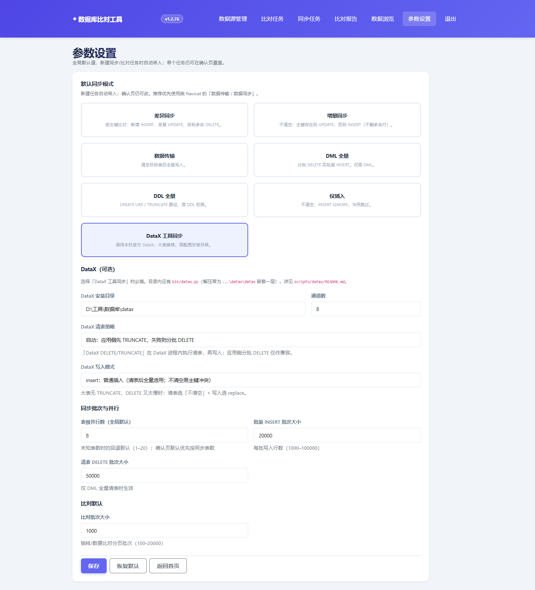](docs/manual/images/10-settings.png)

`docs/manual/images/10-settings.png`

---

## 版本更新摘要（倒序）

完整记录见 [`version-changelog.json`](src/main/resources/version-changelog.json)；下表按**版本从新到旧**排列。

| 版本 | 要点 |
|------|------|
| **1.2.82** | DataX 限流：默认同时 1 进程、通道 4，避免表级并行撑爆内存 |
| **1.2.81** | 同步混合模式：≥100 万行且已配 DataX → DataX，否则普通 DML |
| **1.2.80** | 详细比对定位 SQL：主键 IN（分段）+ SELECT 仅主键与差异字段 |
| **1.2.79** | 修复手动勾选表范围未生效；全部表支持包含通配；条数一致也可打开全表做详细比对 |
| **1.2.78** | 任意表可详细比对（不依赖条数差异）；金额/Hash/索引弹窗也可下钻 |
| **1.2.77** | 指定表详细比对：主键/索引/状态/业务日期/金额画像 + 差异行定位 + 源·目标 SQL |
| **1.2.76** | 重新执行任务名优化：改为「原名 - 重新执行 MM-dd HH:mm」 |
| **1.2.75** | 比对报告增加「重新执行」按钮 |
| **1.2.74** | 条数差异支持「查看差异数据」，按主键展示仅源/仅目标行 |
| **1.2.73** | 数据浏览全屏布局，表格区域占满视口 |
| **1.2.72** | **全站登录认证**；默认复杂密码见 `application.yml` |
| **1.2.71** | DataX 清表新增 DATAX_DELETE / DATAX_TRUNCATE |
| **1.2.69～1.2.70** | DataX 写入模式 insert/replace；修复 No database selected |
| **1.2.63～1.2.68** | **DataX 工具同步**；日志监控、清表策略、看门狗、锁等待重试 |
| **1.2.60～1.2.62** | 超大表流式 batch 写入；心跳显示均速与近段速度 |
| **1.2.57～1.2.59** | 任务级 Hikari 连接池；差异同步主键分块；GoldenDB 并行上限 |
| **1.2.52** | 数据源配置迁入独立 H2 库 `./data/datasource` |
| **1.2.44～1.2.47** | 数据传输 / 数据同步 / PK_UPSERT；同步连接数可临时调整 |
| **1.2.33～1.2.43** | **参数设置**模块；同步草稿编辑；实时进度日志 |
| **1.2.15～1.2.28** | 比对报告提取同步草稿；AppToast/AppConfirm；同步 HTML 报告 |
| **1.2.8～1.2.14** | 任务级连接池；同步报告；数据源 SQL 导出 |
| **1.2.0～1.2.7** | 同步全量/增量；堡垒机连接；库名映射；表级并行 |

---

## 快速开始

### 环境

- JDK 8+
- Maven 3.6+

### 编译与启动

```bash
cd db-compare
mvn "-Dmaven.test.skip=true" package
java -jar target/db-compare-1.2.82.jar
```

访问 **http://localhost:8080/**，使用 `application.yml` 中配置的账号登录。

### 推荐体验路径

1. **数据源管理** — 添加源库/目标库（直连或经堡垒机 Token）  
2. **比对任务** — 执行演示任务「【演示】多表条数差异比对」  
3. **比对报告** — 查看条数差异 → 提取为同步草稿 → 确认页「开始同步」  
4. **同步任务** — 查看进度、报告与失败表重同步  

演示库首次启动自动创建（约 12 表，`PUBLIC` + `SHOP`）。强制重灌：删除 `data/demo/.demo_version` 后重启。

### 配置要点

```yaml
server.port: 8080
db-compare.security:
  enabled: true
  username: admin
  password: <生产务必修改>
db-compare.encryption.key: change-me-in-production
db-compare.datasource-store.url: jdbc:h2:file:./data/datasource
spring.datasource.url: jdbc:h2:file:./data/dbcompare
```

---

## 架构概览

```
浏览器 (Thymeleaf + JS)
    │ HTTP（登录拦截）
    ▼
Controller — DataSource / Compare / Sync / Report / Viewer / Settings
    ▼
Service — CompareTaskRunner / SyncTaskRunner / DataxProcessRunner …
    ▼
JDBC — 业务库（源/目标，按任务连接）
H2   — 任务库 ./data/dbcompare + 数据源库 ./data/datasource
```

---

## 注意事项

1. **权限匹配模式**：DML 至少 SELECT/DELETE/INSERT；DDL 模式另需 CREATE/RENAME/TRUNCATE。  
2. **堡垒机 Token**：临时账号过期后需重新获取；连接失败时在数据源页「测试连接」排查。  
3. **内网部署**：同步程序时不要覆盖 `./data/datasource`（数据源独立库）。  
4. **登录认证**：默认开启，勿将实例暴露公网；关闭认证仅用于本地调试（`db-compare.security.enabled=false`）。

---

## 开发与测试

**约定（强制）：** 新增/变更接口须补单测；每次改动后执行 `mvn test`（见 [`.cursor/rules/regression-testing.mdc`](.cursor/rules/regression-testing.mdc)）。

```bash
mvn test
mvn "-Dmaven.test.skip=true" package   # 仅打包时可跳过测试
```

### 截图更新

```bash
# 先启动应用，再执行（默认 http://localhost:8080）
node scripts/capture-screenshots.mjs
# 或指定端口：BASE_URL=http://localhost:18080 node scripts/capture-screenshots.mjs
```

### 大表压测

见 [`scripts/loadtest/README.md`](scripts/loadtest/README.md)。

### Maven 内网镜像

本仓库提供 `.mvn/settings.xml` 与 `.mvn/maven.config`；IDEA 需 Override 指向该 settings。详见 [`docs/VERSIONING.md`](docs/VERSIONING.md)。

---

## 相关文档

| 文档 | 说明 |
|------|------|
| [`docs/manual/README.md`](docs/manual/README.md) | 截图手册与更新说明 |
| [`docs/VERSIONING.md`](docs/VERSIONING.md) | 发版流程 |
| [`docs/SCHEMA_MIGRATION.md`](docs/SCHEMA_MIGRATION.md) | 应用库 schema 迁移 |
| [`docs/GOLDENDB_SETUP.md`](docs/GOLDENDB_SETUP.md) | GoldenDB 配置 |
| [`scripts/datax/README.md`](scripts/datax/README.md) | DataX 集成 |

## 许可证

MIT License
